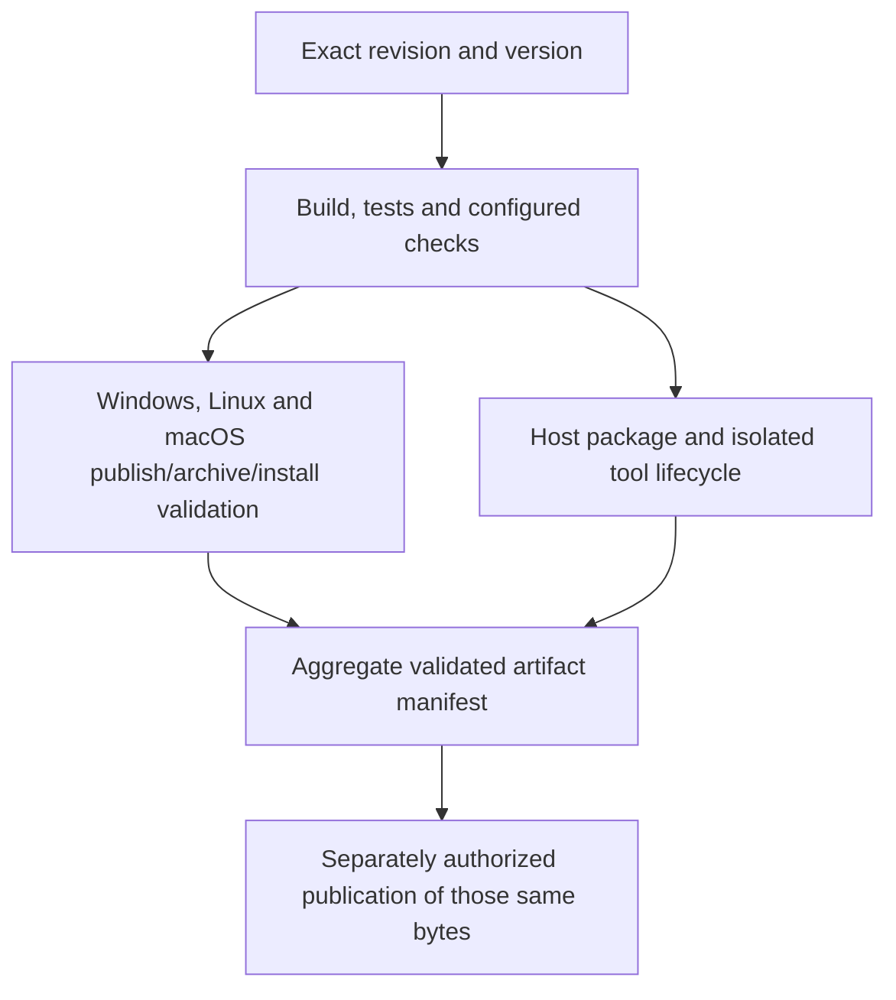

# Release-readiness remediation design

Date: **2026-10-07**

Status: **Written specification awaiting user review; conversational design approved**

Target: **Scrinia 0.6.0**, stable candidate, all active release units

Baseline: `6a8d4a78151dc8238ea18ef2bf3839b66c2fed9d` plus the assessed working-tree changes

## 1. Intent, decisions and boundaries

Make the current Scrinia checkout a reproducible, truthful release candidate by resolving every confirmed finding, advisory and evidence gap in the October 7 release-readiness assessment. Preserve the user's existing work and provide evidence for the resulting candidate, not merely a list of completed edits.

The user selected all release units and current working-tree inputs, requested that all issues be addressed, chose to retain version **0.6.0**, chose **installation through `scri setup`** for bundled embeddings, and approved the proposed remediation direction. This document records that direction in implementable contracts. Approval of the conversation authorized this specification; written-spec review and subsequent implementation-plan review remain required by the invoked brainstorming workflow. No implementation or release publication is represented as approved or completed by this document.

Active release units are:

- The immutable `scrinia` NuGet tool, with sole command `scri` and both local stdio MCP modes, workspace and shared.
- Plain and embeddings release archives for `win-x64`, `linux-x64` and `osx-arm64`.
- Core, MCP and plugin libraries as dependencies of those units, not additional independent package releases.

The public `IMemoryStore` boundary remains unchanged. Tracking precedence, `UserHome.Resolve`, workspace-only enabled-base configuration, local stdio transport, and the no-Git-process runtime rule remain intact. Retired HTTP/web/merge functionality is not restored. The work does not introduce a general plugin manager, marketplace, new remote server, automatic repair of malformed memory content, or general persistence-framework rewrite.

Sources:

- [Current assessment](../../../RELEASE-READINESS.md) and [requirements map](../../../RELEASE-REQUIREMENTS.md).
- [Approved October 5 hardening design](2026-10-05-release-hardening-design.md).
- [Contributor contract](../../../AGENTS.md), [NMP format](../../../NMP_SPEC.md), [security guarantees](../../security.md), and the active project/workflow/publisher definitions.
- [Assessment evidence](../../reviews/release-readiness/2026-10-07/assessment-validation.json): 968 captured product inputs unchanged during assessment, 27 mapped requirements, and fresh command/probe evidence. These local evidence files are ignored by Git and are not portable proof unless retained.

This specification supplements the October 5 design. It resolves the archive-layout conflict in favor of its version/RID layout and defines the missing installation behavior. Historical specifications, plans and dated changelog entries remain unchanged. Living requirements and documentation will be updated with the new decisions during implementation.

### Design alternatives considered

| Approach | Tradeoff | Decision |
| --- | --- | --- |
| Patch tracking catch blocks only | Small diff, but leaves unverifiable completion records and unrelated configuration writers outside recovery admission | Insufficient for the observed defect class |
| Extend the memory-oriented transaction framework to all configuration/install work | More uniform abstraction, but imports scope/address/store coupling into four configuration files and plugin directory installation | Unnecessary expansion |
| Small operation-specific tracking coordinator, existing durability primitives, and a separate bounded bundle installer | Covers complete decisions and recovery at each existing ownership boundary without changing public store APIs | Selected |

## 2. Preserve the candidate and restore correct product membership

Capture HEAD, tracked diff, untracked file inventory, per-file SHA-256, file lengths and a restoration manifest before changing membership. Incorporate the active user changes into the implementation candidate deliberately; do not implement against HEAD and accidentally drop them. The exact final candidate must also be verified from a clean checkout.

Positively retired inputs are preserved under a new dated subdirectory of the existing ignored root `archive/`, outside compiler/resource roots:

| Retired input | Evidence / treatment |
| --- | --- |
| `src/Scrinia.Core/Merge/`, `src/Scrinia.Merge/`, `tests/Scrinia.Merge.Tests/` | Restored files correspond to removals in `a8554d09`; preserve complete directories, including ignored descendants |
| `tests/Scrinia.Tests/MergeConfigRoundTripTests.cs` and `MetaMergeSymmetricParityTests.cs` | Same retirement history; presently cause missing-namespace compilation errors |
| `tests/Scrinia.Tests/ReconcileConflictCopyTests.cs`, `ReconcileDurableFormatTests.cs`, `ReconcileMetaProvenanceTests.cs`, `ReconcileScanTests.cs` | Same retired implementation dependency; preserve individually with original paths |
| `src/Scrinia.Mcp/skills/merge-safety.md` | Removed in `ec743cc3`; now embedded by the resource glob and forbidden by retirement tests |
| `src/Scrinia.Server/` legacy web assets | No active project; preserve with retired artifacts, without claiming this directory represents an active HTTP release |

Before each recursive operation, resolve absolute source and destination paths, verify both remain within the intended workspace/archive roots, inspect link/reparse behavior, and never follow an unverified target outside them. Cloud-backed reparse attributes alone are not proof of a symlink or safe recursive traversal. Preserve link identity where appropriate; stop that item if containment cannot be established. Do not delete the source until a complete verified archive copy and restoration manifest exist. Existing archive destinations are never overwritten. Verify copied bytes, inventory completeness and source freshness immediately before removal. Use native PowerShell filesystem operations throughout on Windows.

Preserve active dirty CLI/help sources and `docs/cli-reference.md`, the CRLF behavior and tests in `Nmp2ChunkedEncoderTests.cs`, and active untracked `CliHelpTextTests.cs`. Do not sweep task reports, plans, `.agents/`, `.codex/`, agent memories, or `.scrinia` data into retirement cleanup. An unfamiliar untracked item is not retired merely because it is untracked.

Do not repair membership through broad `Compile Remove` or resource exclusions: existing directory/resource absence contracts must pass, and future reintroduction must be detectable. Keep retirement tests and add an assertion against actual built embedded-resource names. The approved seven skill keys are `auditor`, `qa`, `debugger`, `chaos-engineer`, `onboarder`, `evolutionary`, and `self-reflector`. Compare exact sets across resource inventory and living skill tables; equal counts alone cannot detect substitutions.

## 3. Tracking transaction integrity

### 3.1 Ownership and admission

Introduce a small internal tracking transaction coordinator and journal codec in `Scrinia.Core/Migration`. `LegacyMigrationService.Set`, `Migrate` and `Inspect` delegate their recovery/publication decisions to it. Register new serialized DTOs in `ConfigJsonContext` and the format contract in `DurableFormats`. Reuse `DurableFile`, configuration locks, bounded payload/containment helpers and positive-absence verification; do not route configuration members through memory addresses or scope journals.

All workspace configuration writers must honor retained tracking evidence. Enumerate `WorkspaceConfig.Save`, `Mutate`, public wrappers and their callers; they cannot write unrelated config and then allow a later rollback to erase that write. Under the existing configuration lock, these ordinary writers refuse pending or unreadable tracking evidence with `CONFIG_RECOVERY_REQUIRED`. They do not attempt a workspace-lock upgrade or perform speculative recovery.

Explicit tracking status/set/migration acquire exclusive workspace admission before the configuration lock and perform recovery there. Persistent memory admission checks tracking evidence while holding its workspace lease, before scope/category locks or authoritative mutation. It refuses unresolved evidence and routes the user to tracking status; it does not upgrade shared admission while holding subordinate locks. Ephemeral-only operations remain independent of persistent storage.

Explicit tracking recovery uses a narrow admission purpose that permits inspecting its own retained journal while still enforcing workspace ownership and unrelated recovery restrictions. It must not be rejected by the ordinary tracking-evidence refusal before it can recover. This purpose does not grant ordinary mutation permission or bypass journal validation, and no caller may acquire it while retaining a conflicting shared lease.

The combined lock order is workspace admission, then configuration lock, then any later scope/category ownership. Release the configuration lock before taking scope locks. Configuration-only writers may use the configuration lock without workspace admission, but must never acquire workspace admission while holding it. Nested helpers receive explicit ownership rather than reentering public lock-taking methods or inheriting authority from AsyncLocal depth. Verify the actual caller inventory before wiring this boundary, including configuration calls made from existing admitted operations.

### 3.2 Journal contract

Retain the operation-owned `.scrinia/.tracking-recovery.json` location. New evidence is strict versioned JSON, version 1, containing:

- Operation ID, operation kind (`set` or `migrate`) and decision (`prepared` or `committed`).
- The exact four-member set `config.json`, `.gitignore`, `.gitattributes`, `merge.config`, represented by fixed relative names. Unchanged members still have before/after state so the transaction boundary is unambiguous.
- Each member's before and after state: explicit existence, byte length, SHA-256 and bytes. Absence differs from a present empty file. Hashes establish recorded-state consistency, not authenticity.

Validate the entire journal before any member mutation. Reject duplicate/missing/extra members, duplicate structural properties, absent/unknown versions or decisions, invalid operation IDs, invalid lengths/hashes/Base64, inconsistent existence fields, unsafe paths and overflowing totals. No default-valued DTO property may turn absent required evidence into valid evidence. Use canonical workspace ownership and fixed member names; do not persist arbitrary absolute replay destinations in the new format.

Bounds are 16 MiB per member state, 128 MiB total decoded before/after bytes, 192 MiB serialized journal, and 64 UTF-8 bytes for operation ID. There are exactly eight member states. Enforce encoded/decoded lengths and aggregate budgets before allocating/replaying; use bounded reads rather than `ReadAllBytes` before checking size. Existing files exceeding capacity are refused before preparation or replacement. These limits constrain configuration recovery, not ordinary memory sizes. Keep the constants and their derivation in one owner.

### 3.3 Decision and recovery rules

| State / event | Required behavior |
| --- | --- |
| Validation or capacity failure before preparation | No member mutation; return classified configuration failure |
| Prepared journal durably published | Preserve all before/after evidence; only now publish members |
| Failure before a committed decision can exist | Restore permitted before states, verify the full original set, then clean evidence |
| Rollback failure or inability to inspect a member | Retain evidence, refuse further writes, return `CONFIG_RECOVERY_REQUIRED` |
| All after states published and verified | Durably publish a committed record retaining the snapshots |
| Committed record durable | Never enter rollback because cleanup failed; committed business outcome remains success |
| Cleanup failure after committed outcome | Preserve committed record; expose cleanup warning; explicit recovery verifies after states before retrying cleanup |
| Exception after replacement but before directory synchronization completes | Outcome is uncertain; never infer durability solely from readable replacement bytes and never blindly roll back |
| Prepared recovery after restart | Preflight every member; current states must be recorded before/after states. Restore and verify before states; retain evidence on any failure |
| Committed recovery after restart | Verify the complete after state and clean evidence only; do not replay predecessor state |
| Unexpected external member contents | Preserve evidence and external contents; refuse destructive recovery |

For uncertain decision publication, retain lock ownership while rereading bounded evidence. A record belonging to this operation with verified after states may be durably re-established as committed; only a successful durable write establishes that outcome. If identity/state/durability cannot be proved, retain the evidence and return recovery-required. Temporary files or in-memory flags are not sufficient evidence. Once a durable commit is established, subsequent cleanup errors cannot reclassify it as a failed transaction.

Before rollback or committed cleanup, validate all members before altering any. On restart after partial rollback, any combination of the recorded before/after states remains eligible for continued prepared recovery; an unknown third state is not. Directory deletion/absence checks must distinguish true absence from inspection failure. Cache invalidation/refresh follows verified resulting state; a cache hit cannot bypass the recovery gate.

Preserve declared codes and exit classes: proven compensated durable-write failure is `CONFIG_WRITE_FAILED`; failed/uncertain recovery is `CONFIG_RECOVERY_REQUIRED`, exit class 4. Malformed retained journal evidence must not be disguised as an ordinary malformed workspace config or silently removed. No new dedicated recovery CLI is introduced: `scri tracking status` performs explicit recovery and reports unresolved evidence; set/migration also enter the same boundary.

### 3.4 Legacy evidence

Fully validated old `prepared` records remain recoverable under bounded parsing, the original fixed target set, canonical path checks and verified restoration. Preserve original evidence until recovery succeeds; do not normalize unsafe recorded paths into trusted paths. Old prepared records lack after-state hashes, so restore compatibility must be explicit: only the existing validated fixed-target replay behavior is retained, with a documented requirement to stop old writers and preserve a backup before recovery. Do not claim new third-state protection for those legacy records.

Exact legacy `complete\n` has no snapshots and cannot distinguish a clean commit from the reproduced failed compensation. Retain it and return recovery-required. Bare `complete`, other malformed markers and unsupported evidence also remain untouched. Guidance requires backup and deliberate operator reconciliation; it must not suggest deleting a journal merely to make a command pass. Previously completed new-format records clean themselves after verification. No automatic content rewrite or waiver of uncertain legacy state is introduced.

### 3.5 Required regression coverage

Cover both Set and Migrate, not only the reproduced Set instance: post-replacement directory-sync failure, failed compensation, interruption at every decision boundary, cleanup failure after commitment, restart after partial rollback, true absence/empty files, malformed or oversized journals, unknown versions, duplicate/unsafe members, external third-state edits, and every legacy marker variant. Confirm ordinary config writers and persistent store writes refuse retained evidence, ephemeral operations remain usable, no lock-order inversion/deadlock occurs, and caches reflect recovery. Promote the assessment's disposable reproduction into maintained tests.

## 4. NMP/2 integrity and linear chunk processing

Use one internal parsed-header representation in `Nmp2Strategy`; route `ParseHeader`, full decode, chunk metadata/access and append through the same grammar. Preserve the shallow routing behavior of `RecognizesNmp2Prefix` and `CanDecode`; correct comments claiming either establishes complete validity.

The grammar remains `NMP/2 <N>B CRC32:<hex> BR+B64 [C:<k>]`:

- Mandatory exact identifier/codec; nonnegative decimal byte count in the supported integer range; no signs or overflow.
- Mandatory exactly eight hexadecimal CRC digits. Accept lowercase hex for compatibility; emit uppercase. Always compare CRC on full decode.
- Optional positive bounded chunk count, maximum 100,000. Missing chunk count means the existing single-chunk form; malformed counts never default to single-chunk.
- Reject missing, duplicate, misplaced and unknown header tokens. Preserve tolerance for repeated ASCII spaces and the CR of CRLF line endings. Do not introduce BOM normalization or accept a BOM-prefixed in-memory artifact.
- Compare decoded byte length exactly, including declared zero. A valid empty artifact remains valid. Retain the existing 64 MiB cumulative decompression bound and check it during decompression.

Replace LF-first/CRLF-fallback suffix searches with one forward line scanner. Recognize LF, CRLF and mixed endings; preserve exact raw section slices needed for append/copy. Validate sequential chunk marker numbers, each `##PAD:0..2` footer, the declared section count and final terminator. Reject duplicate/missing/out-of-order markers or unexpected trailing non-whitespace content. Each input character is visited a bounded number of times; allocations remain proportional to source/output, not chunk-count times source length.

Reuse the parsed metadata and extracted sections instead of repeatedly reparsing the whole artifact. Full decoding verifies the complete concatenated byte count and CRC. Independent chunk reads validate header/section syntax and bounded decompression but do not claim verification of a whole-artifact CRC when other chunks were not decoded. Whole-artifact publication/append must verify all predecessor content before producing a successor artifact.

Apply the rule to all owners: `Nmp2Strategy`, `Nmp2ChunkedEncoder` full decode/chunk access/append, and the independent append-derivation path in `FileMemoryStore`. Enumerate consumers and error mapping across bundles, shared-base runtime contracts, embeddings artifact sources, MCP memory/file-resource handlers, plugin host and CLI migration. Intrinsic validity belongs in Core; facade-only validation is insufficient.

Add regression cases for both confirmed malformed-header probes; valid empty/nonempty data; negative, overflowing and zero-mismatched lengths; missing/malformed/mismatched CRC; valid lowercase CRC; invalid chunk counts; LF/CRLF/mixed input; marker/footer errors; and append/bundle refusal before mutation. Demonstrate bounded forward scanning with deterministic work-count coverage where practical and a recorded many-chunk scaling experiment; avoid flaky wall-clock assertions or an invented release latency threshold.

Previously accepted malformed artifacts now fail explicitly. Do not silently correct headers, re-encode user memories or weaken import error contracts. Living security and NMP documentation must state the actual accepted grammar and partial-read verification limits.

## 5. Build, analyzer and test reliability

Retain production warnings-as-errors. Apply the October 5 directory-scoped test/benchmark policy only to intentional `CA1707`, `xUnit1030` and `xUnit1031` conventions. Fix all other actionable diagnostics. A framework-owned cleanup pattern may receive a local, explained suppression after confirming actual disposal; do not add redundant disposal ownership to satisfy an analyzer superficially.

The failed-build baseline's 288 warnings include 251 `CA1707` and 37 other diagnostics (`CA1861`, `CA1001`, `CA1859`, `CA2016`, `CA1866`, `CA1050`, `CA1816`). This is a lower bound: previously blocked Core/MCP and dependent embeddings compilation may expose more. Acceptance is a fresh nonincremental Release build with zero errors and zero warnings, not merely resolving this initial inventory. Tighten private implementation types without changing public store interfaces; forward cancellation; share fixture arrays only where mutation cannot invalidate isolation.

All embeddings fixtures reading or changing process-wide `SCRINIA_HOME` join one named nonparallel xUnit collection. Include CLI, initialization, reindex and model-download integrity fixtures, and audit indirect reads through provider/model initialization. Retain `ProcessEnvironmentLock`. Preserve concurrent calls inside cold-start tests; unrelated pure tests stay parallel.

`EmbeddingsPluginCliTests` must consume the built referenced CLI artifact for the actual configuration and runtime rather than `bin/Debug/net10.0/win-x64`. Include runtime files required by child execution. Validate this from Release-only native Windows/Linux/macOS checkouts, without developer Debug outputs. Record genuine model/GPU skips separately from executed coverage.

Remove the retired Merge CI lane and add a regression check that every configured test target exists in the tracked project topology. Make skill parity compare exact resource/documentation sets. Keep version single-sourcing checks. Run the configured XML documentation command and accurately describe its scope: this remediation does not introduce repository-wide XML-comment coverage as a new gate. Rename misleading coverage wording if the command does not enable complete documentation emission; no false coverage claim may remain.

## 6. Bundled embeddings delivery and installation

### 6.1 Archive contract

The stable version comes from evaluated shared MSBuild properties, with no duplicated version literal in publishers. Both publishers and archive validation consume one checked-in payload policy containing the supported plugin ID, RID-native sets and symbol exclusion. Emit the following for an embeddings archive:

```text
scri[.exe]
embeddings-bundle.json
plugins/scri-plugin-embeddings/0.6.0/<rid>/
    scri-plugin-embeddings[.exe]
    approved native payload
```

The plain archive contains the host executable only. The NuGet tool remains managed and immutable; it does not acquire LLamaSharp/native/model/bundle payload dependencies.

The bundle manifest contains schema version 1, fixed plugin ID `scri-plugin-embeddings`, package version, RID, and exact file records of leaf name, length and SHA-256. Package version must equal the host's package version, ignoring informational build metadata, and RID must match the current supported runtime. No prerelease-selection expansion is needed for 0.6.0. Register CLI DTOs in the trimming-safe context.

Bound manifest reads to 64 KiB, records to 32, each file to 512 MiB and total payload to 1 GiB. Validate checked arithmetic and stream file hashes/copies; do not allocate payload-sized buffers. The manifest is an integrity inventory, not a cryptographic signature or proof of publisher authenticity.

Required runtime payloads, besides the executable, are:

| RID | Native files |
| --- | --- |
| win-x64 | `ggml-base.dll`, `ggml-cpu.dll`, `ggml-vulkan.dll`, `ggml.dll`, `llama.dll`, `mtmd.dll` |
| linux-x64 | `libggml-base.so`, `libggml-cpu.so`, `libggml-vulkan.so`, `libggml.so`, `libllama.so`, `libmtmd.so` |
| osx-arm64 | `ggml-metal.metal`, `libggml-base.dylib`, `libggml-blas.dylib`, `libggml-cpu.dylib`, `libggml-metal.dylib`, `libggml.dylib`, `libllama.dylib`, `libmtmd.dylib` |

Stage only approved runtime files from raw publish output; do not include PDBs or blindly manifest every file in a publish directory. Retain the Windows/Linux Vulkan package overwrite and hash verification for its five files; verify the additional CPU dependency against its configured CPU package source. Preserve the explicit macOS CPU/Metal fallback and executable mode. Native execution tests must confirm this payload is sufficient; an additional discovered dependency requires an explicit payload-policy change and matching tests, not silent inclusion of arbitrary publish output.

MacOS archive validation compares the plugin executable separately from the native set. It must not compare the executable-plus-native set to a native-only allowlist. Archives include the root manifest and the full version/RID subtree. Validate extracted archives and actual installer behavior, not only publisher source text.

### 6.2 User flow

- Extracted embeddings release: run `./scri setup` (`scri.exe setup` on Windows). Setup recognizes its sibling `embeddings-bundle.json`.
- Existing NuGet installation: run `scri setup --embeddings-source <extracted-release-root>`.
- Without an explicit source or sibling manifest, retain normal model/hook setup behavior. An explicitly supplied missing or invalid source is an error, never a silent fallback.
- `--embeddings-source` points to a directory, not an archive, URL or arbitrary executable. Explicit source wins over sibling discovery. Combining it with hook-only setup/uninstall flags is rejected rather than silently skipping installation.
- Installation occurs only in explicit setup. Ordinary serve may retain existing Model2Vec first-run preparation, but does not install bundles implicitly.

Setup reports installed version, RID, destination, activation result and model-preparation result. Describe macOS as the supported CPU/Metal fallback rather than promising Vulkan there.

### 6.3 Installer transaction and selection

Use a small internal CLI installer, separate from legacy migration. Validate the manifest, exact approved inventory, file identities/hashes, current version/RID and source containment before mutation. Reject traversal, duplicates, links into other trees and unknown payloads; do not execute unverified source files. Snapshot hashes alone do not eliminate source races: hold stable read handles where supported and revalidate staged bytes. Resolve conflicts with higher-priority environment/custom-plugin selection before promising activation. An incompatible explicit selection returns a selection-conflict result; do not modify environment variables or claim the plugin was selected anyway.

Under a home/plugin installation lock, create a unique sibling staging directory beneath the canonical `SCRINIA_HOME/plugins/scri-plugin-embeddings/0.6.0/` directory. Copy only approved files, preserving Unix executable mode and source contents. Verify staged inventory and hashes, flush file contents, and publish the whole RID directory by same-filesystem rename with appropriate parent-directory synchronization. Incomplete staging directories must not match discovery's RID path.

An existing complete version/RID installation with identical immutable payload is an idempotent success. Preserve mutable `state/` separately from exact runtime-file comparisons, and reject unrecognized extra runtime files. Different immutable content at the same identity is a conflict: do not overwrite, merge or delete it. Other versions and state remain untouched. Concurrent installers serialize and reach the same rules.

A crash before directory publication leaves only undiscoverable attempt-owned staging. Cleanup may remove only proven attempt-owned staging under the installation lock; it never recursively removes an unknown directory. A post-rename synchronization failure is uncertain: inspect the final inventory and durably establish the directory outcome before reporting success, or return an installation failure with retained complete files and retry guidance. Never remove a potentially committed installation to compensate for a later configuration error.

After verified installation, record the selected version/name using the existing workspace configuration authority and its repaired recovery admission. Preserve higher-priority environment settings. If configuration selection fails, leave the complete installed payload and prior configuration in place, return a typed installed-but-configuration-failed outcome, and provide idempotent retry guidance. Model download failure likewise leaves the verified installation in place; setup does not report full completion until every required stage succeeds.

The internal result distinguishes invalid bundle, incompatible version/RID, selection conflict, existing-content conflict, installation failure, installed-but-configuration-failed and success. Render an explicit diagnostic and nonzero setup exit for failure; no new public plugin-management API or general JSON CLI mode is needed. Existing normal setup success remains exit 0.

### 6.4 Legacy compatibility

Keep genuine legacy flat-asset migration behavior separate. It must explicitly recognize and exclude the new manifested/versioned bundle source, otherwise its recursive move would consume source files and create duplicated hierarchy. New installation neither relies on nor sets the old one-time migration marker. Preserve existing supported home discovery; never add an executable-relative runtime fallback. Tests must cover an old marker, no configured plugin version, an existing legacy flat tree, and a new manifested bundle in the same release/install lifecycle.

### 6.5 Installation tests

Cover both extracted-host and NuGet-host flows, clean homes, idempotent repeat, explicit source precedence, hook-option conflicts, host version/RID mismatch, missing/extra/tampered files, unknown manifest versions, bounds, unsafe paths/links, concurrent installs, copy/hash/rename/synchronization faults, destination conflicts, preserved mutable state and unchanged source. Verify failed selection/model preparation reports its actual stage while preserving committed installation. Run installed plugin startup/handshake in each native lane; separate native loading from optional real GPU/model inference.

## 7. Release automation and artifact identity

Provide a reusable validation workflow callable by CI and release orchestration, plus a validation-only manual entry. Pin every run to an exact revision, record the resolved SHA, version, SDK/OS and artifact hashes, and operate on clean checkouts. Validation has no package-publication secret or release-upload permission. CI artifact storage for later consumption is permitted; it is not a public release.



All native jobs and package/lifecycle checks must succeed before publication becomes eligible. Preserve the full test suite, warnings policy, retirement/resource checks and required recovery coverage. A failing platform cannot coexist with an independently successful NuGet push. Do not rebuild during publication: download the artifacts of the selected successful run, verify SHA/version/hash identity, and publish exactly those bytes.

Replace the current release-published trigger arrangement with explicit gated orchestration that can stage a draft release before making it public. The public identity is `v0.6.0` / package `0.6.0`; require agreement between tag target, shared version and validated manifest. Confirm package destination eligibility/ownership and secrets through the normal release process before publication. The earlier public NuGet metadata lookup returned no version list; it proves neither ownership nor permission.

Publishing a package and GitHub release cannot be one atomic cross-service transaction. Stage verified GitHub assets on a draft, publish the exact validated NuGet package, then publish the GitHub release. Retain an explicit progress record of external outcomes and artifact digests for retries. If NuGet publication succeeds but release publication fails, retry only remaining operations after verifying identity. If a version already exists, do not hide the conflict with `--skip-duplicate` or publish a different artifact under the same version. Any existing artifact must be verified as the exact intended one before treating an operation as already complete.

Implementation includes workflow changes and validation preparation. Actual push/remote execution must follow the user's available authorization and app permissions; public publication is a separate final action. Lack of a native runner or matching remote evidence remains UNKNOWN, not a pass or implicit waiver. No automatic branch-protection changes are included.

## 8. Living documentation and remaining advisories

Update installation, plugin-authoring, package readme, getting-started and CLI reference together with the implemented flow. Remove unsupported standalone embeddings-tool installation instructions. Document runtime hierarchy, bundled source integrity limits, immutable package/source behavior, selected-provider conflicts and partial-success retry outcomes.

Correct all reported drift:

- README list defaults must match the actual CLI signature/help.
- Workspace MCP tool count/table must match the eleven registered tools; keep the shared surface separately identified.
- Security and architecture docs must distinguish local inference from first-run Model2Vec/GGUF downloads and optional remote providers. State network behavior of setup versus serve accurately.
- Use `scri show`, not the nonexistent CLI `scri recall` example.
- AGENTS must describe both local stdio servers, actual parity/version/XML checks, and the current status of old versus newly fixed recovery findings.
- Record stricter NMP validation and tracking-journal compatibility in Unreleased release notes without modifying historical dated entries.

Preserve all established bundle/file-entity admission, recovery evidence, capacity, reserved-path and CLI/MCP parity guarantees. Document any relevant strict refusal introduced by this remediation. Do not add performance claims from synthetic or incomplete evidence; preserve earlier measured Model2Vec limitations. Native GPU inference and long-running benchmark suites remain optional unless separately selected; basic plugin process/payload checks are required.

Refresh NuGet dependency advisories for the final dependency graph. No arbitrary severity threshold is introduced by this spec; any newly found actionable issue is triaged visibly and must not be silently counted as a clean scan. A NuGet scan does not certify native dependencies or unknown vulnerabilities.

## 9. Acceptance and complete requirement coverage

Each existing requirement retains its ID. Update the reusable map for approved source/contract changes, including six native files where the old Windows/Linux five-file check was incomplete. Record final candidate-specific evidence separately; do not rewrite the October 7 failures into historical passes. Preserve a dated baseline report before refreshing the current report.

| Requirement | Required evidence / completion condition |
| --- | --- |
| RR-BLD-01 | Forced Release solution build succeeds from repaired checkout and final clean candidate |
| RR-BLD-02 | Same nonincremental build has zero errors and zero warnings under the narrow policy |
| RR-TST-01 | Current default solution suite succeeds, with per-project results and explained skips |
| RR-TST-02 | One nonparallel environment collection, retained cross-process guard and passing cold-start/CLI tests |
| RR-CI-01 | Every workflow target is present in tracked topology; no retired Merge lane |
| RR-CI-02 | Matching final clean revision executes all required gates; remote evidence identified by SHA |
| RR-CI-03 | Exact approved skill sets match built resources and both documented inventories |
| RR-CI-04 | Configured XML documentation command passes and its coverage is described truthfully |
| RR-PKG-01 | Single shared 0.6.0 version, package `scrinia`, sole tool command `scri`, tag/manifest consistency |
| RR-PKG-02 | Fresh package content tests prove managed/offline payload and exclusion of retired/native/model/workspace assets |
| RR-PKG-03 | Fresh host pack succeeds; package hash retained |
| RR-PKG-04 | Windows host/plugin publish passes with exact approved native payload provenance |
| RR-PKG-05 | Native Linux plain/embeddings publish, archive extraction, native checks and setup installation pass |
| RR-PKG-06 | Native macOS equivalent passes with separate executable and CPU/Metal native validation |
| RR-PKG-07 | Full isolated install/update/uninstall, both stdio handshakes and package-tree immutability pass |
| RR-PKG-08 | Windows plain/embeddings archives extract, validate exact runtime files/hashes and install successfully |
| RR-DOC-01 | Documented setup-based plugin installation is executed successfully for extracted and NuGet hosts |
| RR-DOC-02 | Recovery guidance matches new journal decisions and legacy refusal behavior without unsafe deletion advice |
| RR-REC-01 | Set/Migrate fault matrix, configuration admission and restart recovery preserve proven outcomes/evidence |
| RR-REC-02 | Relevant full bundle/file-entity regression suite passes after admission changes; original protections retained |
| RR-COMP-01 | Mandatory metadata, valid-empty, malformed-header, append/import and LF/CRLF regression matrix passes |
| RR-API-01 | Public store boundary and both local stdio surfaces preserved; no retired remote/HTTP surface |
| RR-REL-01 | Selected stable 0.6.0 identity recorded; exact clean candidate/artifacts pinned; publication eligibility separately verified |
| RR-REL-02 | Nested version/RID archive contract implemented consistently across publishers, installer, tests and living docs |
| RR-ADV-01 | Fresh advisory scan retained, findings if any explicitly triaged; no broader certification claim |
| RR-ADV-02 | Every listed documentation discrepancy fixed and publication depends on all validated artifacts |
| RR-ADV-03 | Forward scanner preserves raw sections and demonstrates bounded work/scaling without fragile timing assertions |

Known commands, from repository root and prefixed with `rtk proxy` where full logs are required:

```text
dotnet build Scrinia.sln -c Release --no-incremental -v minimal
dotnet test Scrinia.sln -c Release --no-restore --logger trx --results-directory <fresh-results>
dotnet build Scrinia.sln -c Release -warnaserror:CS1591
dotnet pack src/Scrinia/Scrinia.csproj -c Release --no-restore -o <fresh-feed>
pwsh -NoProfile -File publish.ps1 -OutputDir <fresh-windows-output> -Platform win-x64 -WithEmbeddings
./publish.sh <fresh-linux-output> --platform=linux-x64 --with-embeddings
./publish.sh <fresh-macos-output> --platform=osx-arm64 --with-embeddings
dotnet list Scrinia.sln package --vulnerable --include-transitive --format json --no-restore
```

Also execute plain publisher variants, configured parity/version checks, archive/extraction checks and targeted tests introduced by this design. Run `--no-build` test invocations only after a successful build of the exact candidate/configuration. Full lifecycle tests must not depend on mutable developer package feeds or model directories. Test downloads/fakes and real inference limits must be identified in the evidence.

No old pass is carried forward after its relevant input changes. A required failure means NOT READY; missing required native/environment evidence means UNVERIFIED after confirmed failures are cleared. READY requires all applicable required gates satisfied, no unresolved material requirement and no invented exception. Do not downgrade a gate solely to obtain a favorable verdict.

## 10. Implementation boundaries and sequencing

This is one coordinated remediation with focused ownership boundaries; the later plan will turn it into executable tasks and choose the user-approved execution method.

1. Preserve and classify candidate inputs, then remove positively retired inputs from active roots through verified quarantine. This unblocks complete compilation diagnostics.
2. Implement tracking recovery/admission and strict NMP/scanning changes with failure-first regression tests. Independently scoped analyzer/test-harness and delivery work may follow the ownership boundaries in the plan.
3. Implement manifest-driven publishers, bounded setup installation and regression coverage; update workflow dependency/identity rules against those contracts.
4. Update living documentation, exact resource guards and the requirements map. Review .NET correctness and user-facing copy at the appropriate implementation stage.
5. Run local gates, all native validation and full package lifecycle; materialize and verify a clean candidate. Save the final readiness report with remaining limitations stated honestly.

Expected primary owners are `LegacyMigrationState` plus new internal journal/coordinator and config/store admission helpers; `Nmp2Strategy`/`Nmp2ChunkedEncoder`/append derivation; analyzer configuration and affected tests; publishers/shared payload policy; CLI Setup plus a small manifest/installer; workflows; and living documentation. No task may silently expand to unrelated public API restructuring or native-model performance work.

Every new JSON type uses its appropriate source-generated context. Explicit ownership and lock ordering must remain reviewable. Source/test changes, generated evidence and preserved user artifacts are tracked separately in implementation records. Committing a design-only document does not make the currently failing product baseline green or approve product implementation.

## 11. Specification self-review

The written contract covers all 27 mapped IDs, includes the additional configuration/RID test-path defect, and preserves all user-selected decisions. Recovery distinguishes prepared, committed and uncertain outcomes; legacy evidence limitations are explicit. Installer publication is separate from configuration/model completion and legacy migration; archive sources remain intact. Exact native payloads include the CPU dependency missed by the earlier five-file validation. Publication uses the already validated bytes and acknowledges partial external completion.

No product fixes, workflow dispatch, public publication, full-spec approval or implementation-plan approval are claimed by this document. Unavailable native environments are acceptance limitations with defined outcomes, not unspecified design decisions. The next stage is user review of this written specification; only approval of it permits implementation planning.
